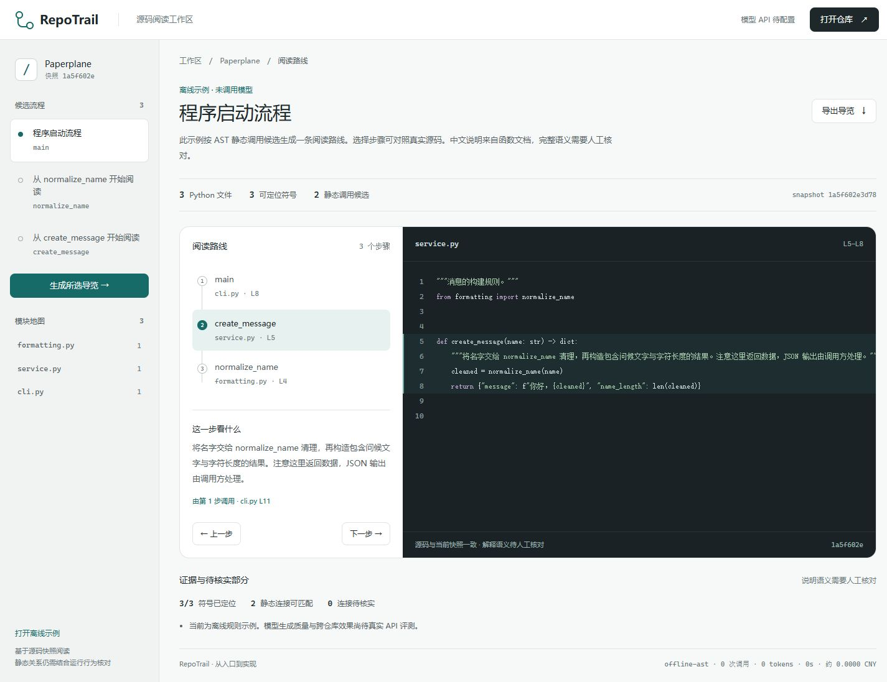

# RepoTrail

Read an unfamiliar Python repository through source-grounded reading trails.

[简体中文](README.zh-CN.md) · [Research](docs/research.md) · [Architecture](docs/architecture.md) · [Evaluation](benchmarks/README.md)

RepoTrail builds a bounded Python source snapshot, suggests reading entry points, and generates a trail through relevant symbols. Each step links to exact source lines. Static call candidates are checked against the snapshot, and unresolved connections remain visible.

The local workspace opens with a clearly labeled offline example. Live generation requires your own Chat Completions-compatible API. Model quality comparisons and independent semantic review are pending.



## Run

Python 3.11 or newer and Git are required. From this checkout, use a virtual environment.

```sh
python -m venv .venv
```

On macOS or Linux, run the environment's interpreter.

```sh
.venv/bin/python -m pip install -e ".[dev]"
.venv/bin/python -m repotrail.cli serve
```

On Windows PowerShell, use the following commands.

```powershell
& .\.venv\Scripts\python.exe -m pip install -e ".[dev]"
& .\.venv\Scripts\python.exe -m repotrail.cli serve
```

Open [the local workspace](http://127.0.0.1:8765).

## Configure live generation

Set `REPOTRAIL_API_KEY`, `REPOTRAIL_BASE_URL`, and `REPOTRAIL_MODEL` in your shell before starting the service. The base URL should end at the provider's API root, such as `/v1`, and support `/chat/completions` with tool calls. `.env.example` documents the settings. Files named `.env` are ignored by Git and are not automatically loaded.

Optional input and output prices are per million tokens. Missing prices or provider usage produce an unavailable cost estimate.

## Command line

```sh
python -m repotrail.cli inspect /path/to/repository
python -m repotrail.cli generate /path/to/repository --output .repotrail/output
python -m repotrail.cli demo
python -m pytest -q
python -m benchmarks.run verify
```

`inspect` accepts a local directory or a public GitHub HTTPS repository URL. `generate --flow` selects an exact candidate ID returned by `inspect`. Exports include JSON, Markdown and CodeTour `.tour` files.

## Scope and evidence

- Up to 300 Python files, 200 KB per file and 4 MB total source
- Immutable source contents and a SHA-256 snapshot digest for each analysis
- Import aliases, relative imports, local function calls and same-class method candidates
- Bounded source-reading tools, up to four generation rounds and one repair attempt
- Static relationship checks, explicit gaps, actual provider usage and optional cost estimates

Python runtime dispatch, inheritance, monkey patching, imported re-exports, object data flow and arbitrary framework behavior require additional analysis. Explanatory prose requires independent semantic review. Cached remote checkouts keep their original version until the local cache is refreshed.

## Foundations

CodeTour informed the export format, PocketFlow informed staged generation, and Aider and Repomix informed context selection. GitHub Spec Kit and matklad's architecture guidance informed project documentation. These references are recorded with implementation-specific decisions in the research notes.

## License

MIT. Design guidance from unslop by Damir Sokolovsky (@heydamir), CC BY 4.0, is credited in THIRD_PARTY.md.

