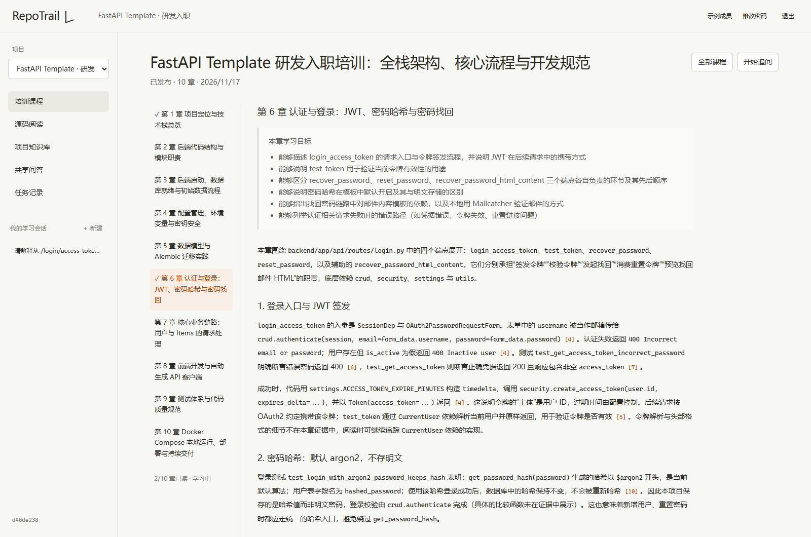
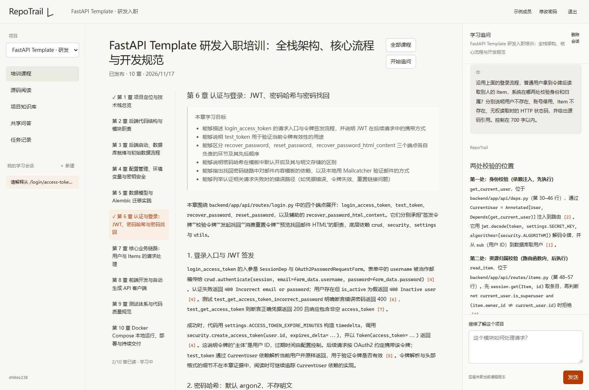
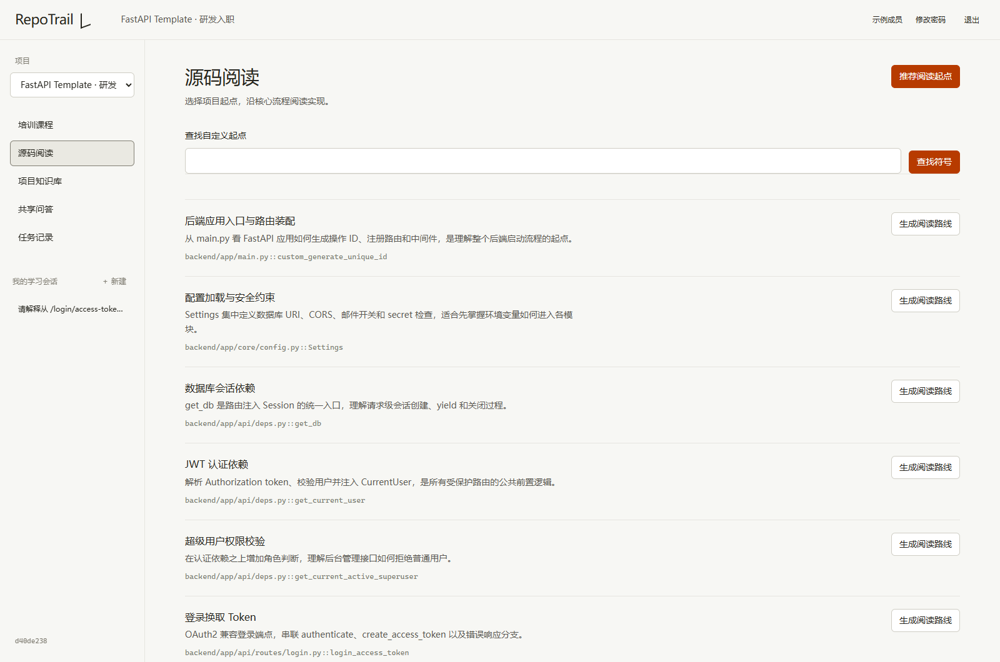
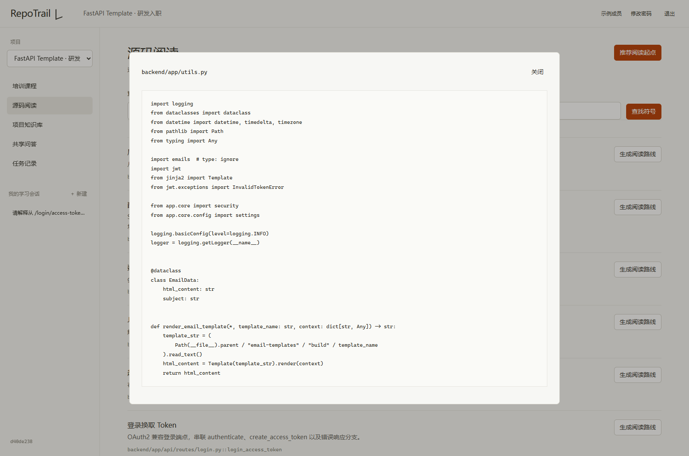
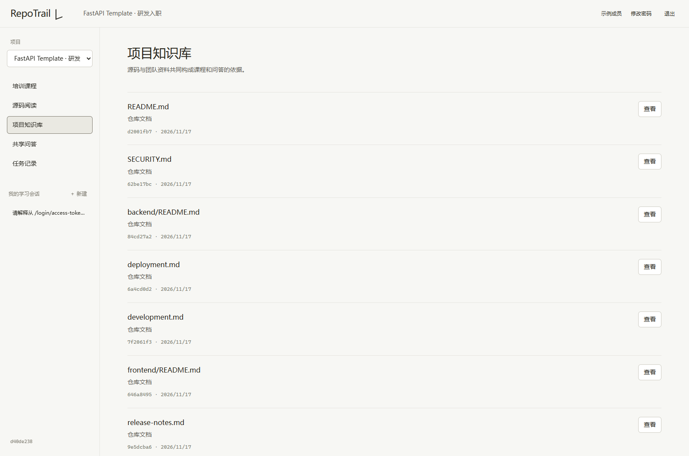
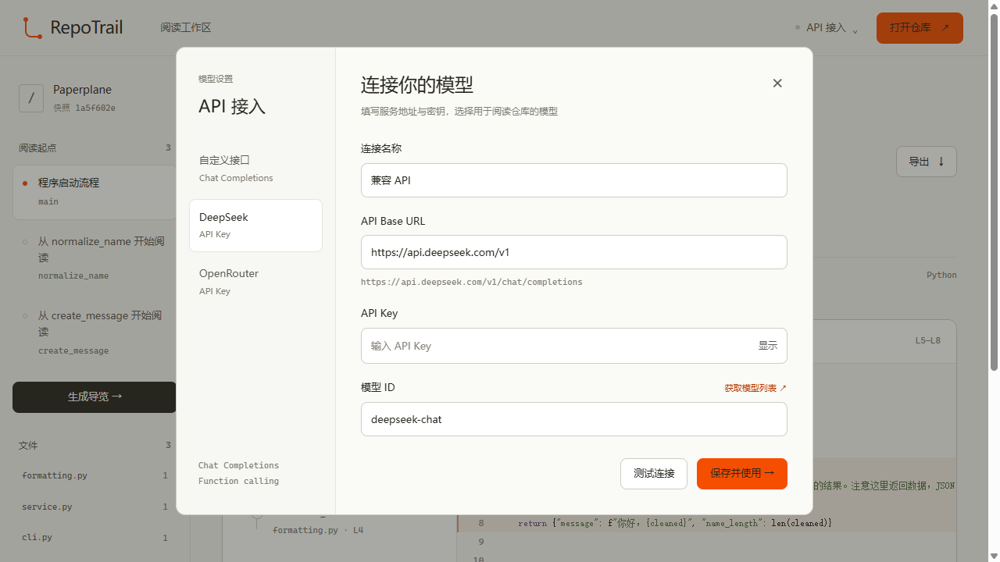

# RepoTrail

连接源码与团队知识，建立可持续学习的研发入职培训工作区。

[English](README.md) · [架构与取舍](docs/architecture.md) · [调研依据](docs/research.md) · [评测方法](benchmarks/README.md)

输入公开 GitHub 仓库或本地目录，查看阅读起点与模块地图，选定一条流程，在源码旁逐步阅读解释。支持导出 Markdown、JSON 和 CodeTour。

团队版提供内置账号与项目授权、Markdown/PDF 知识库、混合检索、课程审核发布、个人持续追问、历史恢复、阅读进度和学习总结验收。

## 团队工作区

```powershell
git clone https://github.com/pengyyyyyyyy/repotrail.git
Set-Location repotrail
python -m venv .venv
& .\.venv\Scripts\python.exe -m pip install -e ".[dev,embeddings]"
& .\.venv\Scripts\python.exe -m repotrail.cli admin create admin --name 管理员
& .\.venv\Scripts\python.exe -m repotrail.cli seed --username admin --source .
& .\.venv\Scripts\python.exe -m repotrail.cli serve --team --port 8766
```

打开[团队工作区](http://127.0.0.1:8766)。本地快速启动使用 SQLite 与内嵌 worker。Docker Compose 配置使用 PostgreSQL、pgvector 和独立持久化任务 worker。[部署、配置与备份恢复](docs/self-hosting.md)



### 带源码引用的持续追问



<details>
<summary>阅读起点、源码预览与项目知识库</summary>







</details>

截图来自本地实际运行页面，使用锁定版本的 FastAPI 官方模板与真实模型 API。[测试资料与实测记录](benchmarks/reports/public-onboarding-2026-11-17.md)

## 单人源码阅读工作区

安装 Python 3.11 或更新版本与 Git，然后在 PowerShell 中执行。

~~~powershell
git clone https://github.com/pengyyyyyyyy/repotrail.git
Set-Location repotrail
python -m venv .venv
& .\.venv\Scripts\python.exe -m pip install -e ".[dev]"
& .\.venv\Scripts\python.exe -m repotrail.cli serve
~~~

打开 [本地工作区](http://127.0.0.1:8765)。macOS 与 Linux 的虚拟环境解释器为 .venv/bin/python。

## 在页面接入 API

1. 点击右上角的 **API 接入**。
2. 选择服务商模板，或填写自定义连接名称和 API Base URL。
3. 输入 API Key，点击 **获取模型列表**，也可以直接填写模型 ID。
4. 点击 **测试连接**，然后 **保存并使用**。

接口需要支持 Chat Completions 与工具调用。Base URL 可以包含服务商自己的路径，程序在其后拼接 /models 或 /chat/completions。

配置保存后立即用于网页，CLI 和评测运行器也会读取同一份本地配置。



连接信息保存在 Git 忽略的 .repotrail 目录中，密钥通过系统凭据库保存。系统凭据库不可用时，网页服务在当前会话中使用密钥。

已有的 REPOTRAIL_API_KEY、REPOTRAIL_BASE_URL 和 REPOTRAIL_MODEL 环境变量同样可以使用。费用估算使用的每百万 Token 单价配置见 .env.example。

## 命令行

~~~powershell
& .\.venv\Scripts\python.exe -m repotrail.cli inspect D:\path\to\repo
& .\.venv\Scripts\python.exe -m repotrail.cli generate D:\path\to\repo
& .\.venv\Scripts\python.exe -m repotrail.cli demo
& .\.venv\Scripts\python.exe -m pytest -q
& .\.venv\Scripts\python.exe -m benchmarks.run verify
~~~

inspect 返回阅读起点，generate --flow 可以指定候选 ID。生成目录包含 trail.json、trail.md 与 reading.tour，后者可在 CodeTour 中打开。

## 公开资料实测

2026 年 11 月 17 日，使用锁定版本的 Requests、Starlette 和 FastAPI 官方全栈模板，合计 167 个 Python 文件、53 份 Markdown 文档，对 15 道固定检索题进行了测试。

| 指标 | 关键词检索 | 混合检索 |
| --- | ---: | ---: |
| 前 5 个结果命中目标文件 | 11/15 | 14/15 |
| 前 5 个结果命中精确代码符号 | 6/10 | 7/10 |
| 文件 MRR@5 | 0.5889 | 0.6800 |

5 路真实 API 问答与 1 个后台向量重建任务同时完成，客户端问答耗时中位数为 13.106 秒。浏览器检查覆盖源码引用和历史恢复。实测记录同时保留了 Flask 基础生成截断，以及第一轮追问遗漏令牌签发函数体的情况。[固定语料、方法与完整结果](benchmarks/reports/public-onboarding-2026-11-17.md)

## 分析范围

默认上限为 300 个 Python 文件、单文件 200 KB、源码总计 4 MB。每次分析保存源码快照与内容摘要，远程仓库使用下载时的缓存版本。

索引涵盖导入别名、相对导入、直接函数调用与同类方法候选。模型通过受限源码工具生成导览，结构检查与修订流程在后端执行。[实现说明](docs/architecture.md)

## 参考项目

API 配置与模型获取流程参考 OpenMinis，导出格式参考 Microsoft CodeTour，生成流程参考 PocketFlow，上下文选择参考 Aider 与 Repomix。[来源与署名](THIRD_PARTY.md)

