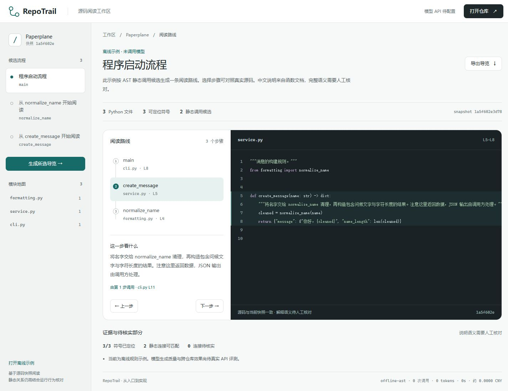

# RepoTrail

沿着源码依据，理解一个陌生的 Python 仓库。

[English](README.md) · [调研依据](docs/research.md) · [需求与验收](docs/spec.md) · [架构与取舍](docs/architecture.md) · [评测方法](benchmarks/README.md)

输入公开 GitHub 仓库或本地目录，查看候选入口与模块地图，选定一条流程，生成逐步阅读路线。每一步展示对应源码、静态连接依据和仍需核实的部分。



## 当前状态

已实现源码索引、本地网页与 CLI、受限源码工具、兼容模型 API、一次补查修订、证据检查和三种导出。默认打开项目自带的离线教学示例。

Requests、Click、Flask 的固定评测集包含十五道源码定位题。参考片段可用脚本核验，独立人工复核与真实模型质量对照仍待完成。

## 快速开始

先安装 Python 3.11 或更新版本与 Git，然后在 PowerShell 中执行。

```powershell
git clone https://github.com/pengyyyyyyyy/repotrail.git
Set-Location repotrail
python -m venv .venv
& .\.venv\Scripts\python.exe -m pip install -e ".[dev]"
& .\.venv\Scripts\python.exe -m repotrail.cli serve
```

打开 [本地工作区](http://127.0.0.1:8765)。按 Ctrl+C 停止服务。macOS 与 Linux 的虚拟环境解释器为 `.venv/bin/python`。

## 接入你的模型

在启动服务的同一个 PowerShell 会话中设置。密钥通过交互输入，避免写进命令历史。

```powershell
$secureKey = Read-Host '模型 API Key' -AsSecureString
$env:REPOTRAIL_API_KEY = [System.Net.NetworkCredential]::new('', $secureKey).Password
$env:REPOTRAIL_BASE_URL = 'https://api.deepseek.com/v1'
$env:REPOTRAIL_MODEL = 'deepseek-chat'
& .\.venv\Scripts\python.exe -m repotrail.cli serve
```

服务地址与模型名按你的服务商修改。接口需要支持 Chat Completions 与 function tool calls。`.env.example` 提供设置说明，程序从环境变量读取配置。

如需费用估算，再设置 `REPOTRAIL_INPUT_PRICE` 与 `REPOTRAIL_OUTPUT_PRICE`，单位为每百万 Token 的价格，并设置对应的 `REPOTRAIL_CURRENCY`。未提供价格或服务商未返回用量时，界面显示费用不可用。

## 可复现入口

```powershell
& .\.venv\Scripts\python.exe -m repotrail.cli inspect D:\path\to\repo
& .\.venv\Scripts\python.exe -m repotrail.cli generate D:\path\to\repo
& .\.venv\Scripts\python.exe -m repotrail.cli demo
& .\.venv\Scripts\python.exe -m pytest -q
& .\.venv\Scripts\python.exe -m benchmarks.run verify
```

`inspect` 返回最多三条候选流程。将候选 ID 传给 `generate --flow` 可以固定入口。生成目录包含 `trail.json`、`trail.md` 与 `reading.tour`，后者可在 CodeTour 中打开。

## 如何理解证据

源码定位来自分析时保存的快照，文件、行号和内容由程序确定。静态连接来自 AST 中可解析的调用表达式。说明文字和实际运行路径需要结合源码进行语义复核。

解析范围涵盖部分函数调用、导入别名、相对导入与同类方法。动态派发、继承调用、重导出和实例变量数据流可能产生连接缺口。工具会输出已定位内容与未确认部分。

仓库上限为 300 个 Python 文件、单文件 200 KB、源码总计 4 MB。超过上限会给出错误。读取时尊重 Git 的排除规则，跳过符号链接和常见依赖目录。远程仓库缓存固定在首次克隆版本，更新后需要重新建立快照。

## 求职展示材料

需求、架构与模块学习路线位于 docs。GitHub 个人主页草稿位于 github-profile/README.md。主页材料按目前已实现内容编写，实验结论在实际完成评测后补充。

