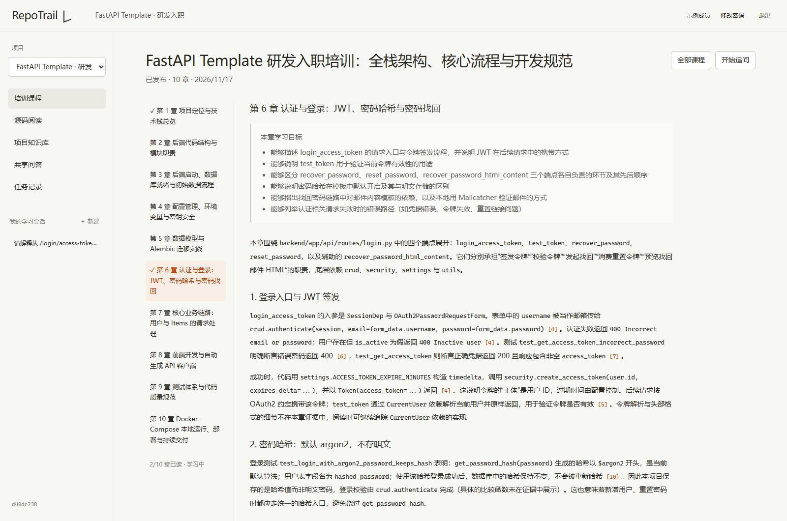
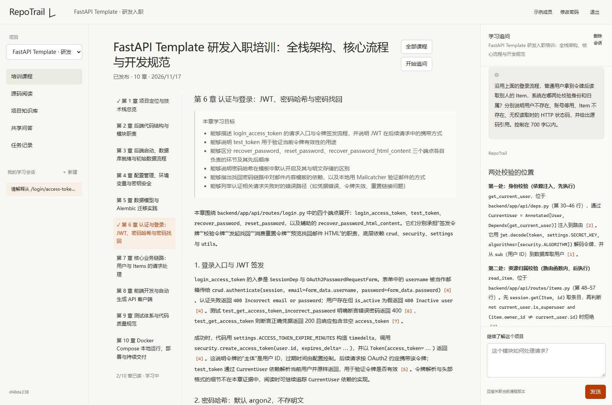

# Public onboarding evaluation · 公开资料实测

2026 年 11 月 17 日，Windows、Python 3.12.14、本地 SQLite、内嵌 worker。检索使用本地 `sentence-transformers/paraphrase-multilingual-MiniLM-L12-v2`，生成与追问使用已配置的真实 `deepseek-flash` API。

## 测试资料

以完整仓库中的 Python 源码和 Markdown 文档构建入职培训测试语料，覆盖 HTTP 客户端、ASGI 框架与全栈业务模板。提交版本、许可、问题、参考文件、参考符号和源码片段保存在 [语料清单](../public-onboarding.json)。

| 资料 | 固定版本 | Python 文件 | 符号 | 文档 | 检索片段 | 许可 |
| --- | --- | ---: | ---: | ---: | ---: | --- |
| Requests | `3c7baaa05ab4` | 37 | 787 | 13 | 1,652 | Apache-2.0 |
| Starlette | `271c277da0ff` | 84 | 2,147 | 33 | 4,398 | BSD-3-Clause |
| FastAPI Full Stack Template | `0.10.0 / d40de23896d2` | 46 | 163 | 7 | 526 | MIT |
| 合计 | | 167 | 3,097 | 53 | 6,576 | |

对应的上游仓库和许可文件可通过固定提交访问。[Requests](https://github.com/psf/requests/tree/3c7baaa05ab4aa49cc819ce3a819d260de19c157) · [Starlette](https://github.com/Kludex/starlette/tree/271c277da0ff64e2048a4d46ecc812b9d61db5f6) · [FastAPI Template](https://github.com/fastapi/full-stack-fastapi-template/tree/d40de23896d27d15c17a7bf9649123fd167a0aa8)

选择模板版本时也检查了上游较新的 `0.12.0` 和主分支。Python 3.12 的 AST 解析器无法解析其中 `backend/app/api/deps.py` 的异常捕获语法，本轮主体评测固定使用能够完整解析的 `0.10.0`。源码及文档全部来自公开项目，测试账号与会话在本地创建。

## 检索测试

每个仓库 5 道固定题，共 15 道。10 道代码题包含精确标识符，5 道文档题使用中文问题。两种方案使用相同项目快照、相同片段与相同查询范围，各返回前 5 个片段。

文件 Hit@5 按前 5 个结果是否包含预期文件统计。文件 MRR@5 使用首个预期文件的倒数排名，未命中计 0。代码题另外检查片段的 `symbol_id` 是否与参考符号完全一致。标注由开发助手检查固定版本源码后整理，独立人工复核待完成。

| 指标 | 关键词检索 | 混合检索 |
| --- | ---: | ---: |
| Requests 文件 Hit@5 | 3/5 | 5/5 |
| Starlette 文件 Hit@5 | 3/5 | 4/5 |
| FastAPI Template 文件 Hit@5 | 5/5 | 5/5 |
| 合计文件 Hit@5 | 11/15 | 14/15 |
| 代码题精确符号 Hit@5 | 6/10 | 7/10 |
| 文件 MRR@5 | 0.5889 | 0.6800 |

混合检索遗漏了 `Starlette.__call__` 的目标文件。代码题的符号命中结果还包含同一文件内函数定位的缺口。语料包含项目测试代码，后续可用生产代码与测试代码的候选排序消融检查这些缺口。[逐题查询、排名及返回位置](public-retrieval-2026-11-17.json)

## 真实模型导览对照

沿用项目已有的 Requests、Click、Flask 固定入口与 15 个参考符号。每个仓库运行一次单次基础生成和完整工作流。下表覆盖率按输出步骤涉及的参考符号计算。

| 仓库 | 基础生成 | 完整工作流 | 完整工作流耗时 |
| --- | --- | --- | ---: |
| Requests | 2/5，完成 | 2/5，完成 | 10.84 s |
| Click | 5/5，完成 | 5/5，完成 | 15.94 s |
| Flask | 失败，输出达到 2,800 Token 上限 | 5/5，完成 | 34.78 s |

首次执行在 Flask 基础生成失败时中止。评测运行器现已支持保存失败的状态、费用和原因，并继续处理其余样本。继续执行时复用了已完成且源码、模型、服务地址与提示版本一致的 Requests 和 Click 输出，再次执行 Flask 的两个方案。Flask 基础生成再次截断，共发生 7 次生成尝试。

这些结果保留了 Requests 的覆盖不足与 Flask 的失败。完整工作流的语义正确性评分仍为空，参考符号覆盖率可用于检查阅读路线覆盖范围。[对照记录及用量](public-comparison-2026-11-17.json)

## 课程、权限与多轮追问

FastAPI Template 项目生成了 30 个可定位阅读起点与 10 章课程，正文合计 36,129 字符。课程覆盖定位、模块职责、启动、配置、迁移、认证、业务接口、前端开发、测试与部署。开发助手抽查源码后将这份公开示例课程发布到本地测试项目。

用管理员通过实际接口创建的示例成员测试了以下流程。

- 分配项目前访问项目返回 404，加入项目后返回 200。
- 草稿课程返回 404，发布后可以读取。
- 其他项目返回 404，模型设置返回 403。
- 管理员读取成员个人会话返回 404。

两轮真实追问均完成，客户端观测耗时分别为 6.55 s 和 7.62 s。第一轮询问登录、认证与 JWT 签发，回答引用了登录和认证函数，缺少 `create_access_token` 函数体的检索依据，并在回答中明确说明了该缺口。第二轮沿用登录背景，正确给出用户不存在 404、账号停用 400、条目不存在 404、越权读取 403，并引用对应函数。

第一轮对三个要求定位的函数体命中两个。上述抽查由开发助手对照源码完成。课程全文尚待独立人工复核。[完整问答、引用位置、课程信息与权限记录](public-live-2026-11-17.json)

## 并发与浏览器测试

在已加载本地嵌入模型的服务上，同时提交 5 个问答和 1 个后台向量重建任务。5 个问答由同一个管理员账号发起，背景资料为 FastAPI Template 的固定快照。

| 观测项 | 结果 |
| --- | ---: |
| 并发问答完成数 | 5/5 |
| 客户端问答耗时中位数 | 13.106 s |
| 客户端问答最大耗时 | 13.749 s |
| 后台向量重建 | 完成，18.798 s |
| 5 个问答的输入 / 输出 Token | 56,551 / 6,470 |
| 5 个问答的配置单价估算费用 | USD 0.0247293 |

耗时包含排队、检索、模型服务及轮询。此次记录针对单机 SQLite、小型语料与热缓存，问答内容未进行质量评分。PostgreSQL 多用户回归由 CI 运行，硬件资源占用尚未采样。[并发明细](public-live-2026-11-17.json)

浏览器测试使用无头 Microsoft Edge、1600×1060 视口，通过真实登录和页面导航执行 8 项检查，涵盖成员打开项目、阅读起点、源码预览、知识库、已有问答、引用打开、刷新恢复、章节及消息数恢复。页面异常和登录后的 HTTP 错误均为 0。截图直接保存浏览器渲染结果，内容来自本次公开语料和真实 API。[浏览器记录](public-live-2026-11-17.json)

本地 Python 回归结果为 87 项通过、1 项跳过。新增回归验证了基础生成失败后，运行器仍会记录失败并执行完整工作流。





## 复现

先按 [部署说明](../../docs/self-hosting.md) 创建管理员并启动团队版服务，配置实际模型与本地嵌入模型，然后执行。

```sh
python -m benchmarks.public_onboarding prepare
python -m benchmarks.public_onboarding index --username admin
python -m benchmarks.public_onboarding retrieval
python -m benchmarks.run compare
```

`prepare` 下载固定源码版本并验证参考片段。已有 checkout 的版本不匹配时会提示所需版本。`index` 使用交互输入的管理员密码建立三个项目及其源码、文档索引。首次索引会加载本地嵌入模型，`retrieval` 复用同一模型执行 30 次检索。`compare` 使用真实 API，输出包括失败样本。`--resume` 可复用具有匹配服务指纹、模型、源码摘要、入口和提示版本的已完成导览。

课程与问答可在页面生成。发布公开示例课程后，使用示例账号打开项目、创建多轮会话，再记录页面。

```sh
python -m pip install playwright
python -m benchmarks.capture_onboarding --username demo-learner
python -m benchmarks.team load --username admin --project PROJECT_ID --course COURSE_ID --concurrency 5 --background
python -m pytest -q
```

截图命令默认使用已安装的 Microsoft Edge。命令行提示输入密码，测试脚本也支持 `--password-file` 指向受控本地文件。生成与并发测试会产生模型服务费用，单价取运行配置。本文记录的课程、起点和两轮追问估算费用合计 USD 0.0672834，首次中断的导览调用没有保存用量，其费用未计入对照文件。原始运行目录位于 Git 忽略的 `benchmarks/results` 和 `.repotrail/evaluation`，公开记录移除了本地项目、账号、会话和任务 ID。
