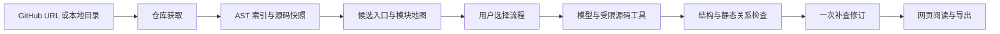

# 架构与取舍

团队培训工作区通过 `serve --team` 启动。部署与使用方式见 [团队版部署](self-hosting.md)，产品与阶段验收条件见 [团队培训平台规划](team-onboarding-plan.md)。

## 团队培训架构

`team/server.py` 提供登录、项目授权、资料接入、课程审核发布、个人会话、分享和学习总结验收接口。请求通过服务端会话、CSRF 和项目成员关系检查。

`team/database.py` 定义账号、授权、版本资料、任务、课程、消息、进度、总结与用量等实体。团队部署使用 PostgreSQL 与 pgvector，本地功能验证支持 SQLite。源码快照保存实际读取的内容，课程绑定快照与文档清单。

`team/knowledge.py` 解析 Markdown 和文本型 PDF，按符号或文档段落分块，使用关键词与向量结果融合检索。代码索引和仓库文档发现都遵循 Git 忽略规则。文档与代码片段保留项目、资料版本及来源位置。

`team/worker.py` 通过持久化任务、租约和续期处理后台工作，支持一个索引或课程任务与五个并发追问。课程按大纲与章节分别生成，保存章节断点，并在数据库事务中记录已提交结果。模型使用短来源编号，程序映射为真实片段 ID。

追问结合当前章节、近期问题和相关历史引用检索资料，补充可静态解析的调用候选。原始历史保存在数据库中，模型使用有限历史与摘要。个人会话只由本人通过应用访问，分享的问答对相应项目成员可见。

课程通过管理员审核发布。成员记录阅读进度并提交学习总结，管理员确认完成或给出补充意见。总结提交与审核记录保留版本，账号或项目权限变化会在后续访问中重新检查。

`team/security.py` 管理 Argon2 密码哈希和数据库加密凭据，部署主密钥保存在数据卷或由环境配置。`compose.yaml` 将 Web、worker 与数据库组织为可复现的共享部署。

## 数据流

## 模块地图

| 模块 | 责任 |
| --- | --- |
| repository.py | 校验 GitHub URL、克隆公开仓库或打开本地目录 |
| index.py | 文件边界、Python AST、符号、导入别名、静态调用候选、入口推荐 |
| models.py | 索引数据结构、模型导览的 Pydantic 校验结构 |
| llm.py | 兼容 API、请求上限、接口错误、实际用量与费用估算 |
| provider.py | 页面与命令行共用的模型配置、系统凭据存储、即时切换 |
| engine.py | 上下文选择、受限工具、生成轮次、证据检查和一次修订 |
| export.py | JSON 原子写入、Markdown 与 CodeTour 输出 |
| server.py | 本地 API、内存快照、任务队列与资源访问 |
| cli.py | 可复现的命令行入口 |
| static | 仓库选择、阅读步骤、源码对照、导出、模型配置与团队培训界面 |
| benchmarks | 提交版本固定的参考题、片段核验和模型对照运行器 |

## 关键决策

### Python AST 作为首版索引

分析对象固定为 Python，标准库 AST 提供可核对的起止行与语法节点，能够减少安装和多语言解析维护成本。源码保存在同一快照中，模型引用符号 ID，文件与行号由程序回填。

索引可以匹配部分导入别名、相对导入、直接调用与同类方法。函数参数或局部赋值遮蔽的名称会保守跳过。静态候选仍受 Python 动态机制影响，需要结合运行行为理解。

### 显式源码工具

生成从入口邻域、至多 180 个符号摘要与一组初始源码片段开始。模型可调用 read_symbols 与 search_code。读取被限制在分析时的 Python 快照中，工具返回真实行号，搜索结果也提供包含该行的符号 ID。

至多四轮生成，前三轮允许工具，最后一轮要求最终 JSON。发现结构性问题后再尝试一次修订。模型客户端最多六次请求，限制单次输出、上下文大小与请求超时。调用统计保存于每次结果。

### 校验分层

源码定位检查确认符号与片段来自快照。关系检查确认已读符号中存在可解析的调用表达式，保存该表达式的位置。说明语义由固定问题集与人工评分核对。

阅读路线可以先看一个调用，再回到父步骤看另一个调用。每一步连接会指明实际来源步骤。暂时无法解析的连接保留 unresolved 状态。

### 可复现快照

快照摘要覆盖被读取的 Python 内容、相关 README 内容和项目配置。结果还记录 Git HEAD 与工作区更改状态，本地修改以快照内容为准。干净工作区的 CodeTour 记录 Git ref，存在本地更改时保留快照提示。Markdown 和 JSON 保留内容摘要与源码片段。

### 本地部署与任务状态

FastAPI 只绑定 127.0.0.1。生成在一个独立工作线程执行，最多两个任务占用执行与等待名额。快照和结果保存在有限的内存集合中，服务重启后需要重新打开仓库。

页面通过 provider 接口配置服务地址、API Key 和模型 ID。连接元数据原子写入本地 .repotrail/provider.json，密钥保存到系统凭据库。系统凭据库不可用时使用服务会话内存。网页、CLI 和评测运行器通过 ProviderStore 读取相同配置，环境变量提供初始配置。

原生前端使用 textContent 构造仓库与模型文本。源码仅由当前内存快照返回。HTTP Host 与写入请求来源受本地限制，前端静态资源使用同源策略。

### 错误与部分结果

模型输出由 Pydantic 限制字段和步骤数。未知符号、错误入口、重复步骤与缺失静态关系会进入问题清单。一次修订失败时保留已解析的初次结果，并记录补查未完成。

## 成本与性能的解释

模型服务返回实际 prompt_tokens 与 completion_tokens 时才记录完整用量。费用按用户配置的每百万 Token 单价估算，币种保持一致。价格缺失或服务商缺少用量时不生成费用估算。

当前没有跨请求生成缓存，因此对照实验会产生真实模型请求。远程仓库下载有版本固定的本地缓存。评测运行器保存原始输出，便于人工检查和后续分析。

## 需要进一步验证的部分

入口推荐基于配置、语法与名称启发式。复杂库可能需要按项目类型增加候选识别策略。首次上手的阅读顺序也需要实际使用者反馈。

当前符号地图与读取上下文都有明确上限，较远的目标需要模型主动搜索。模型是否会及时补查、工具调用兼容性、修订是否改善结果，都需要用真实服务运行固定评测后判断。

