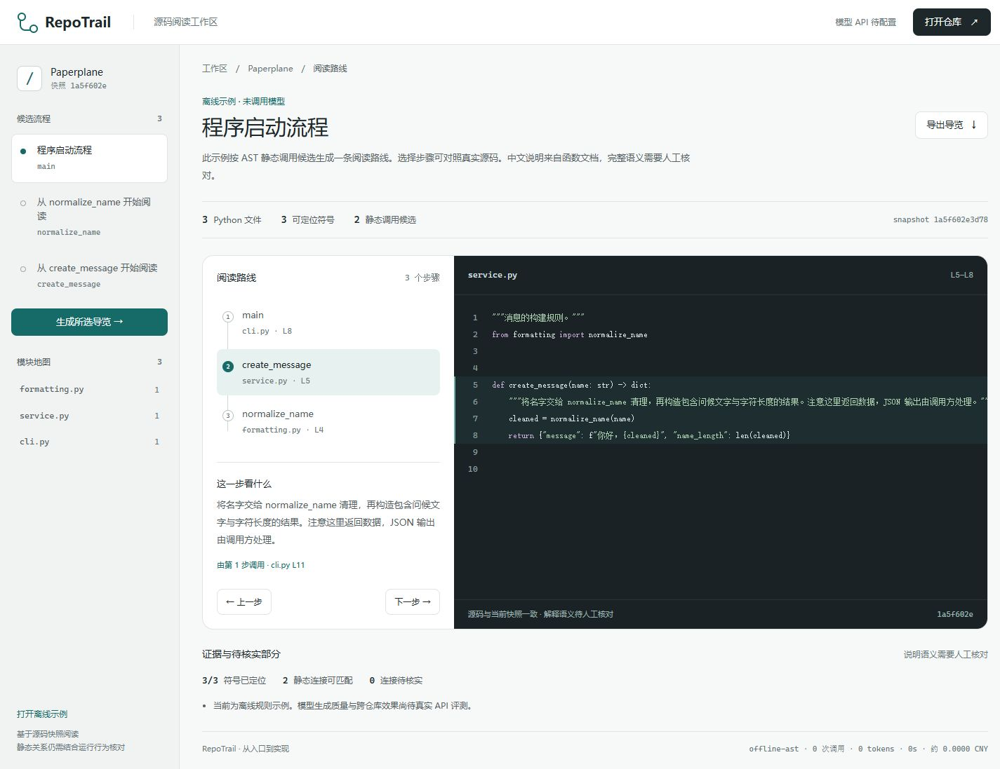

# pengyyyyyyyy

Python developer exploring AI applications, source analysis and developer tools.

我关注如何让模型生成的解释具有可核对的源码依据，也在记录实现中的工程取舍和失败案例。

## Featured project

### RepoTrail

沿着源码依据，理解陌生的 Python 仓库。

从仓库入口与模块地图出发，生成可逐步阅读的路线，对照真实代码，并查看静态调用关系与待核实部分。

- Python AST 符号索引与版本化源码快照
- 受限源码工具、结构检查与一次补查修订
- 本地阅读工作区、CLI、Markdown 与 CodeTour 导出
- Requests、Click、Flask 的固定源码核对题集

目前正在补充真实模型对照与独立人工语义评分。

[查看项目](https://github.com/pengyyyyyyyy/repotrail) · [架构与取舍](https://github.com/pengyyyyyyyy/repotrail/blob/main/docs/architecture.md) · [评测方法](https://github.com/pengyyyyyyyy/repotrail/blob/main/benchmarks/README.md)

## Current focus

Python · AI agent workflows · Code navigation · Evaluation

